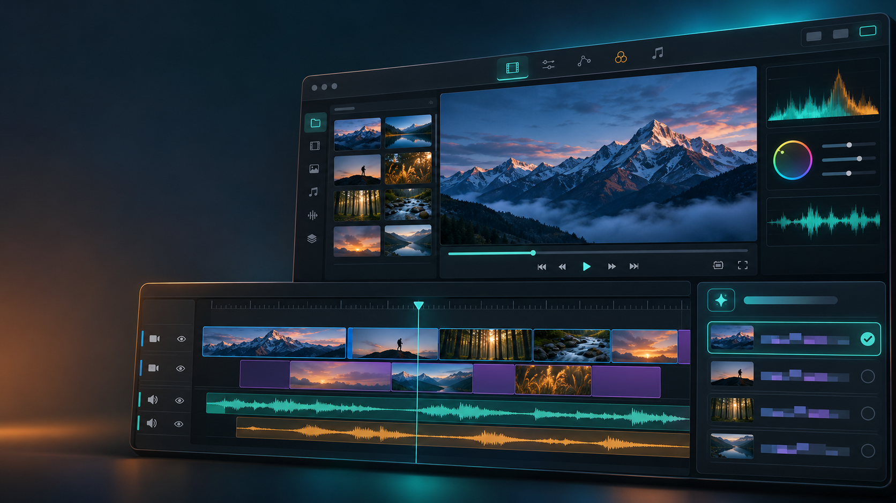

# H3 — Footage Editing Prototype

> **Status:** planning concept. This repository is currently a blank starting point; the product scope and sequence below are proposed for discussion, not implemented features.

### H3 editor concept

H3 is a working name for a lightweight footage editing prototype. The first goal is to turn a folder of clips into a clean, watchable rough cut with a clear timeline and a dependable export. Start with a small, useful editing loop; add time-saving assistance only after the basic workflow feels solid.

### What we want to learn

- Can someone import a folder of mixed footage and quickly find the clips they need?
- Can they assemble and adjust a rough cut without fighting the timeline?
- Do preview and export behave reliably on the target machine and media formats?
- Which repetitive editing steps are worth automating?

### Proposed execution plan

The sequence is intentionally staged. Each phase should produce something usable and answer a question before the next layer is added.

1. **Agree on the prototype boundary.** Pick the first user and editing task, target platform, supported formats, and a small sample footage set. Decide what “good enough” means for playback and export.
2. **Build the vertical slice.** Import clips, show thumbnails and basic metadata, create a project, place clips on a single video track, trim/reorder them, and preview the sequence.
3. **Save and export.** Persist project state, recover after reopening, and export one common preset. Compare output duration and playback against the timeline.
4. **Try it with real footage.** Observe a few people completing the same short edit. Record where they pause, repeat actions, lose context, or wait.
5. **Optimize the measured bottlenecks.** Prioritize responsive scrubbing, quick clip discovery, and predictable export based on observations and timings.
6. **Test one assistive idea.** Prototype optional scene grouping or a suggested rough cut; keep every suggestion editable and compare it with a manual workflow.

### First prototype scope

| Include in the first slice | Defer until the slice works |
| --- | --- |
| Local media import and clip bin | Multi-camera editing and collaboration |
| One video track with trim, split, reorder, and delete | Advanced compositing, effects, and color grading |
| Preview, project save/reopen, and one export preset | Cloud projects and account systems |
| Basic clip search/sort and visible export progress | Automatic edits that change footage without review |

### Optimization ideas to validate

These are hypotheses, not commitments. Measure the current experience first, then pick the smallest change that addresses the biggest pain.

- **Faster media startup:** generate lightweight proxies or thumbnails in the background; keep originals untouched and show processing state.
- **Smoother scrubbing:** decode around the playhead, use proxy media when needed, and avoid blocking the interface during media work.
- **Faster clip finding:** extract duration, resolution, and timestamps at import; later test opt-in scene grouping or searchable transcripts if users need them.
- **More reliable exports:** run export work separately from interaction, expose progress and errors, and keep the project recoverable after failure.
- **Less timeline friction:** test keyboard shortcuts, snapping, and direct trim handles with users before increasing timeline complexity.
- **Useful assistance:** suggest, never silently apply, scene selections or a rough-cut order; make undo and manual edits obvious.

### Prototype diagram

The editable Excalidraw plan is [`docs/prototype-plan.excalidraw`](docs/prototype-plan.excalidraw). It shows the build sequence and the feedback loop that decides what to optimize next.

### How we will judge the prototype

Use a short, repeatable edit task and capture task completion, time to first preview, number of manual clip searches, playback stalls, export success/failure, and user-reported friction. Set numeric targets after the first baseline run so they reflect the actual hardware and sample footage.

### Suggested next decision

Choose one target user and one representative editing task, then collect a small footage set. Those choices will let us turn this plan into concrete interface sketches and implementation milestones without guessing at the workflow.
